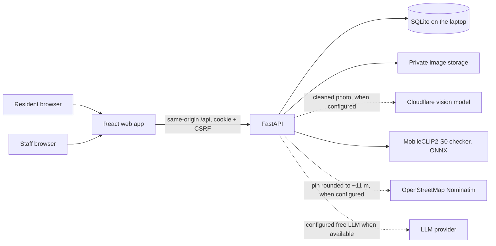
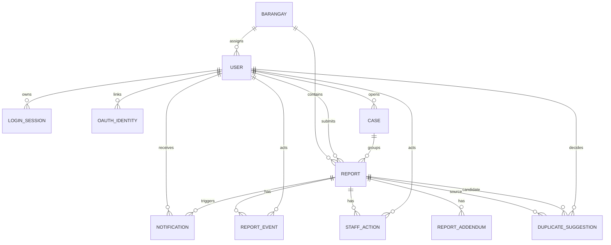

# Architecture and data flow

FastAPI alone decides ownership, roles, status changes, and access to original images. The browser sees only authenticated `/reports/{id}/image` responses. The model prediction, resident-selected category, and staff-verified category occupy distinct report fields. Model absence requires manual selection; staff still verifies all accepted reports. Chat report status uses a server-side scoped lookup, never a model-generated status.

`REPORT_EVENT` records actor and timestamp for each status change. `DUPLICATE_SUGGESTION` has a model version, score, decision, actor, and decision time; both original reports remain. New reports get suggestions automatically within a per-category radius (50 m for small fixtures, up to 300 m for floods). A `CASE` groups reports staff confirmed as one incident: each keeps its own photo, categories and history, they share one status (a joining report walks every step, logged), and a case's category comes only from staff verification. Accepted reports open a one-report case, which residents see on the shared map without photos, descriptions or names; a resident's "I see this too" report joins only after staff confirm it. Staff also see a suggested priority (`priority.py`): category severity, the AI's hazard flags, extra independent residents (at most +3) and a report in the last three days add points, shown with every reason. It never reorders the queue unless staff choose that sort, and residents never see it. Its weights are untuned starting values. Staff actions can record external coordination, but no API sends reports to another agency.

Before a resident submits, `/nearby` checks for their own open report or a neighbours' open case near the pin; the resident may add the photo and a note to it instead. Such additions are `REPORT_ADDENDUM` rows: append-only, so the report stays as staff first saw it. New reports and additions notify the barangay's staff and every administrator (`NOTIFICATION.kind`). Photos are shrunk in the browser and again on the server (1,600 px), faces are blurred where the YuNet model finds them (`privacy.py`), and all metadata is removed; the capture time, camera and GPS are read first so `trust.py` can give staff hints (pin far from the photo's GPS, old photo, no details). Residents never see those hints. Kap's brief (`brief.py`) counts the queue in SQL; the optional LLM only rewords the counts and is discarded if it states any other number.

Parked since 3 November 2026 (the project now runs locally, see [mobile.md](mobile.md)): the Render container serves website and API under one origin. Supabase stores PostgreSQL rows and private photos. Sessions and authorization remain in FastAPI; Supabase client roles have no application-table policies. Storage credentials stay on the server, which checks report permissions before returning image bytes. Google identities map by provider and subject; matching password-account emails are not automatically linked.

## Data safety

The one laptop holds the only copy. SQLite runs in write-ahead-log mode with foreign keys and secure delete on (`db.py`), so a slow reader can't make a commit fail. Importing the app touches no database: the server builds it on request. Before a schema upgrade the database is copied beside itself. `barangai/backup.py` backs up the database and the photos its rows point to, and restores them to any folder. Rows store the full path of the folder a photo was first saved in; `media.py` looks in today's photo folder first, then that path. If a blur that's switched on can't run, the server won't start and uploads are refused with a 503 (`privacy.check_ready`), so a broken install can't quietly keep faces sharp.

## Staff jurisdiction

A `BARANGAY` holds a name and a GeoJSON boundary. On submission the server places the report in the barangay containing its pin, in plain Python so that tests on SQLite and the free hosting tier need no geometry extension or outside service. A pin outside every boundary leaves the report without a barangay, for administrators only. Staff are limited to their own barangay in `authorized_report` and in the queries that list reports (`barangays.report_filter`); administrators are not limited. Loading boundaries also places older reports that have none, and a case's reports follow its earliest report, because reports in a case share one status. A report that already has a barangay never moves when a boundary changes. `duplicates.py` is frozen, so a router-level guard limits its decision route. With no barangays loaded, nothing is enforced and all staff work as one desk. Maps draw a lighter copy of the borders from `/barangays/boundaries`, and the report form previews a pin's barangay through `/barangays/locate`; neither is used to place a report.

## Accounts and audit

An administrator can disable any staff account through the API (`admin.py`), and any account from the command line. `users.disabled_at` is checked on every request (`current_session`) and at sign-in, and disabling also deletes the sessions. Sign-in answers a disabled account exactly as it does a wrong password. Passwords are checked against a short blocklist (`auth.password_problem`) on sign-up, on change and at the command line, and an email gets 50 wrong passwords a Manila day from one address and 500 from all of them, counted in `daily_usage` under hashes, so a stranger guessing locks out only their own device. Temporary passwords are generated, and shown once.

Staff and administrators opening a photo leave a `REPORT_PHOTO_VIEW` row (one per person, report and hour), read only by administrators and removed with the report. Reward creation and price changes leave a `REWARD_CHANGE` row. With the vouchers themselves, that lets `/admin/rewards/log` trace any code. Who an administrator disabled or reset isn't logged yet.

`ERASURE` keeps the ids (and nothing else) of erased reports and accounts. `backup.restore_backup` replays it through the same erase code before copying photos, and puts the old database back if that fails, so a restore can't undo a deletion. Points follow the same rule: a balance never goes below zero, and what can't be taken back (`users.points_owed`) comes out of the next refund. When reports join a case, `points.reconcile_case` leaves one award per resident and one first-reporter bonus, and writes a `merge` entry for each taken back.

`GET /reports` and `GET /notifications` answer `ETag` and `Cache-Control: private, no-cache`, which is what lets the browser revalidate; everything else under `/api` stays `no-store`. The tag hashes the response itself, since the list can change with no row's `updated_at` moving. So an unchanged poll still builds the list on the server but sends 304 with no body. `python -m barangai.metrics` prints follow-through and retention from the database.

## Status rules

`Pending` to `Under Verification` to `Accepted` to `In Progress` to `Resolved`. `Under Verification` may instead become `Rejected`. Acceptance requires a verified category. Residents can read their own reports and history; staff can read and update their barangay's reports; administrators can read and update all reports.
