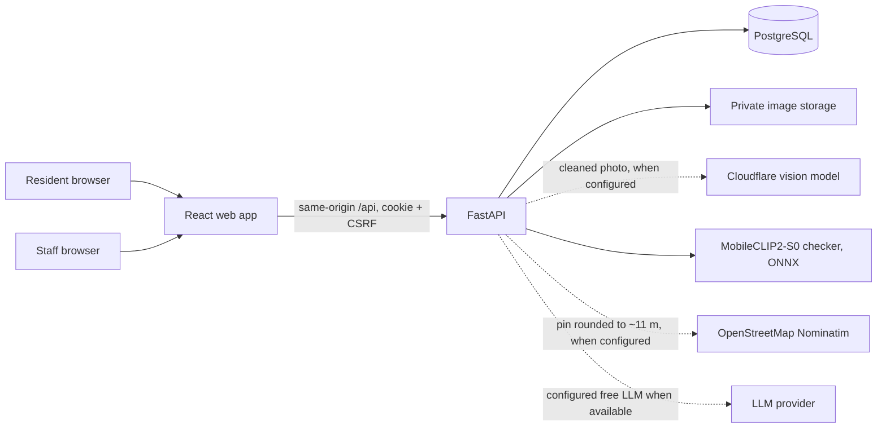
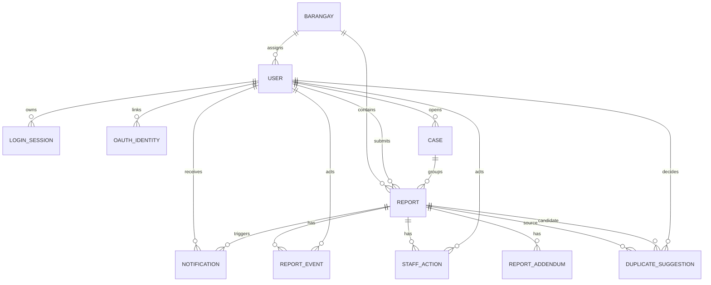

# Architecture and data flow

FastAPI alone decides ownership, roles, status changes, and access to original images. The browser sees only authenticated `/reports/{id}/image` responses. The model prediction, resident-selected category, and staff-verified category occupy distinct report fields. Model absence requires manual selection; staff still verifies all accepted reports. Chat report status uses a server-side scoped lookup, never a model-generated status.

`REPORT_EVENT` records actor and timestamp for each status change. `DUPLICATE_SUGGESTION` has a model version, score, decision, actor, and decision time; both original reports remain. New reports get suggestions automatically within a per-category radius (50 m for small fixtures, up to 300 m for floods). A `CASE` groups reports staff confirmed as one incident: each keeps its own photo, categories and history, they share one status (a joining report walks every step, logged), and a case's category comes only from staff verification. Accepted reports open a one-report case, which residents see on the shared map without photos, descriptions or names; a resident's "I see this too" report joins only after staff confirm it. Staff also see a suggested priority (`priority.py`): category severity, the AI's hazard flags, extra independent residents (at most +3) and a report in the last three days add points, shown with every reason. It never reorders the queue unless staff choose that sort, and residents never see it. Its weights are untuned starting values. Staff actions can record external coordination, but no API sends reports to another agency.

Before a resident submits, `/nearby` checks for their own open report or a neighbours' open case near the pin; the resident may add the photo and a note to it instead. Such additions are `REPORT_ADDENDUM` rows: append-only, so the report stays as staff first saw it. New reports and additions notify the barangay's staff and every administrator (`NOTIFICATION.kind`). Photos are shrunk in the browser and again on the server (1,600 px), faces are blurred where the YuNet model finds them (`privacy.py`), and all metadata is removed; the capture time, camera and GPS are read first so `trust.py` can give staff hints (pin far from the photo's GPS, old photo, no details). Residents never see those hints. Kap's brief (`brief.py`) counts the queue in SQL; the optional LLM only rewords the counts and is discarded if it states any other number.

The selected Render container serves website and API under one origin. Supabase stores PostgreSQL rows and private photos. Sessions and authorization remain in FastAPI; Supabase client roles have no application-table policies. Storage credentials stay on the server, which checks report permissions before returning image bytes. Google identities map by provider and subject; matching password-account emails are not automatically linked.

## Staff jurisdiction

A `BARANGAY` holds a name and a GeoJSON boundary. On submission the server places the report in the barangay containing its pin, in plain Python so that tests on SQLite and the free hosting tier need no geometry extension or outside service. A pin outside every boundary leaves the report without a barangay, for administrators only. Staff are limited to their own barangay in `authorized_report` and in the queries that list reports (`barangays.report_filter`); administrators are not limited. Loading boundaries also places older reports that have none, and a case's reports follow its earliest report, because reports in a case share one status. A report that already has a barangay never moves when a boundary changes. `duplicates.py` is frozen, so a router-level guard limits its decision route. With no barangays loaded, nothing is enforced and all staff work as one desk. Maps draw a lighter copy of the borders from `/barangays/boundaries`, and the report form previews a pin's barangay through `/barangays/locate`; neither is used to place a report.

## Status rules

`Pending` to `Under Verification` to `Accepted` to `In Progress` to `Resolved`. `Under Verification` may instead become `Rejected`. Acceptance requires a verified category. Residents can read their own reports and history; staff can read and update their barangay's reports; administrators can read and update all reports.
